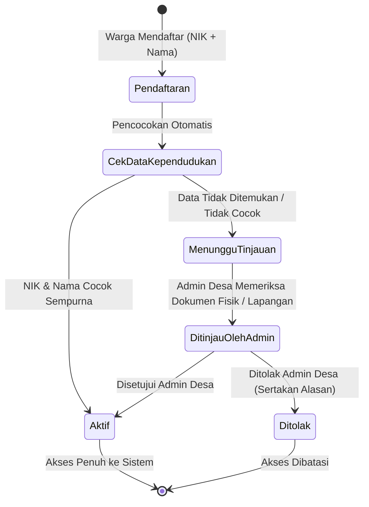
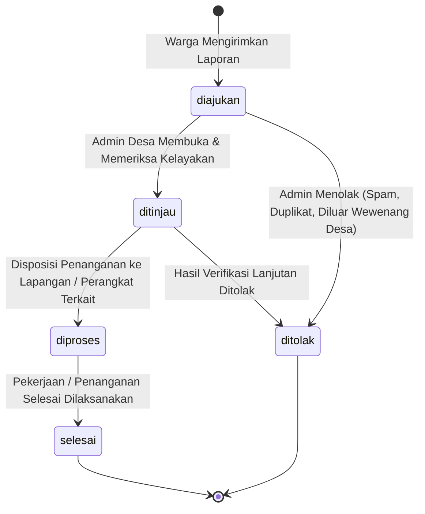

# Arsitektur Sistem Informasi Layanan Pengaduan dan Aspirasi Warga Desa Banjarsari

Dokumen ini merangkum arsitektur aplikasi, batasan hak akses peran, serta alur status akun dan laporan.

---

## 1. Pola Arsitektur Monolit (Blade Full-Stack)

Aplikasi dibangun menggunakan pola arsitektur **Monolit Klasik Berbasis MVC + Service Layer**:

```text
[ Browser / Klien ]
       │  HTTP / HTTPS Request
       ▼
[ Web Server & Middleware Pipeline ]
   ├── SecurityHeaders (X-Frame-Options, X-Content-Type, Referrer-Policy)
   ├── RateLimiter ('login', 'registrasi', 'reset-password')
   ├── Authenticate (Breeze Auth Session)
   ├── EnsureRole (Otorisasi: warga | admin_desa | kepala_desa)
   └── EnsureAccountActive (Validasi status akun: aktif)
       │
       ▼
[ Controller Layer ] (app/Http/Controllers/)
   ├── Warga / Admin / Kepala
   └── Menerima HTTP Request, Validasi FormRequest, Memanggil Service
       │
       ▼
[ Service Layer ] (app/Services/)
   ├── Menampung logika bisnis kompleks, transaksi database, manipulasi berkas
       │
       ▼
[ Domain / Eloquent Model & Policies ] (app/Models/, app/Policies/)
   ├── Aturan Otorisasi (Policy)
   ├── Entitas Data & Casting Enum
   └── Query Builder / ORM
       │
       ▼
[ Basis Data MySQL 8 / SQLite Testing ]
```

---

## 2. Matriks Peran vs Fungsi

Sistem memiliki **3 peran utama**:
1. `warga` — Penduduk desa terverifikasi.
2. `admin_desa` — Pengelola operasional pengaduan dan verifikasi kependudukan.
3. `kepala_desa` — Pimpinan desa dengan akses monitoring dan supervisi laporan.

| Modul / Fitur | Warga | Admin Desa | Kepala Desa | Keterangan |
|---|:---:|:---:|:---:|---|
| **Registrasi Mandiri (NIK + Nama)** | ✅ | ❌ | ❌ | Validasi otomatis ke data kependudukan desa |
| **Login ke Sistem** | ✅ | ✅ | ✅ | Dilindungi rate limiter (5 req/menit) |
| **Ajukan Pengaduan / Aspirasi** | ✅ | ❌ | ❌ | Unggah foto lampiran & detail lokasi |
| **Lihat Riwayat Laporan Pribadi** | ✅ | ❌ | ❌ | Hanya laporan milik sendiri |
| **Beri Tanggapan / Komentar** | ✅ | ✅ | ✅ | Pada laporan yang relevan |
| **Verifikasi / Tinjau Pendaftaran Warga**| ❌ | ✅ | ❌ | Tinjau NIK yang berstatus `menunggu_tinjauan` |
| **Tinjau & Validasi Laporan Masuk** | ❌ | ✅ | ❌ | Mengubah status: `diajukan` → `ditinjau` / `ditolak` |
| **Tindak Lanjut Penanganan Laporan**| ❌ | ✅ | ❌ | Mengubah status: `ditinjau` → `diproses` → `selesai` |
| **Kelola Master Kategori** | ❌ | ✅ | ❌ | Menambah / menonaktifkan kategori |
| **Monitoring & Supervisi Eksekutif**| ❌ | 👁️ (Operasional) | ✅ (Penuh) | Akses visualisasi & rekapitulasi data |

---

## 3. Alur Status Akun Pengguna

Setiap akun pengguna memiliki salah satu dari status berikut:



- **`aktif`**: Akun dapat langsung login dan menggunakan seluruh layanan warga.
- **`menunggu_tinjauan`**: Akun belum dapat mengajukan laporan sampai disetujui manual oleh Admin Desa.
- **`ditolak`**: Registrasi ditolak dengan catatan alasan penolakan.

---

## 4. Alur Status Laporan (Pengaduan & Aspirasi)

Setiap laporan yang diajukan warga melewati alur transisi status sebagai berikut:



Setiap perubahan status dicatat secara otomatis dalam tabel `riwayat_status` lengkap dengan catatan tindak lanjut dan identitas pengguna yang memperbarui status.
