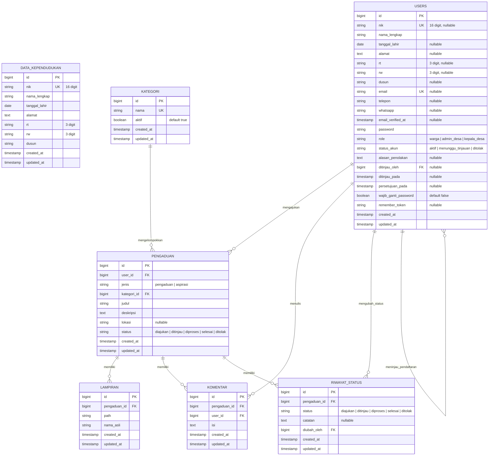

# Dokumentasi Skema Basis Data

Sistem Informasi Layanan Pengaduan dan Aspirasi Warga Desa Banjarsari dirancang menggunakan mesin basis data **MySQL 8** (dan sepenuhnya kompatibel dengan **SQLite** untuk keperluan Automated Testing).

---

## 1. Diagram Relasi Entitas (ERD)

---

## 2. Rincian Tabel dan Kolom

### A. Tabel `data_kependudukan`
Menyimpan data master kependudukan desa sebagai acuan validasi otomatis saat pendaftaran warga.
- `id` (BIGINT, PK, Auto Increment)
- `nik` (VARCHAR 16, UNIQUE, INDEX) — Nomor Induk Kependudukan fiktif desa.
- `nama_lengkap` (VARCHAR 255)
- `tanggal_lahir` (DATE)
- `alamat` (TEXT)
- `rt` (VARCHAR 3)
- `rw` (VARCHAR 3)
- `dusun` (VARCHAR 255, NULLABLE)
- `timestamps` (`created_at`, `updated_at`)

### B. Tabel `users`
Menyimpan akun seluruh pengguna sistem (Warga, Admin Desa, Kepala Desa).
- `id` (BIGINT, PK, Auto Increment)
- `nik` (VARCHAR 16, UNIQUE, NULLABLE) — Wajib untuk warga; opsional untuk admin/kepala desa.
- `nama_lengkap` (VARCHAR 255)
- `tanggal_lahir` (DATE, NULLABLE)
- `alamat` (TEXT, NULLABLE)
- `rt` (VARCHAR 3, NULLABLE)
- `rw` (VARCHAR 3, NULLABLE)
- `dusun` (VARCHAR 255, NULLABLE)
- `email` (VARCHAR 255, UNIQUE, NULLABLE)
- `telepon` (VARCHAR 255, NULLABLE)
- `whatsapp` (VARCHAR 255, NULLABLE)
- `email_verified_at` (TIMESTAMP, NULLABLE)
- `password` (VARCHAR 255) — Bcrypt hash (cost 12)
- `role` (VARCHAR 50, DEFAULT 'warga') — Nilai: `warga`, `admin_desa`, `kepala_desa`
- `status_akun` (VARCHAR 50, DEFAULT 'menunggu_tinjauan') — Nilai: `aktif`, `menunggu_tinjauan`, `ditolak`
- `alasan_penolakan` (TEXT, NULLABLE)
- `ditinjau_oleh` (BIGINT, FK ke `users.id`, NULLABLE, ON DELETE SET NULL)
- `ditinjau_pada` (TIMESTAMP, NULLABLE)
- `persetujuan_pada` (TIMESTAMP, NULLABLE)
- `wajib_ganti_password` (BOOLEAN, DEFAULT false)
- `remember_token` (VARCHAR 100, NULLABLE)
- `timestamps` (`created_at`, `updated_at`)

### C. Tabel `kategori`
Daftar bidang/kategori pengaduan dan aspirasi warga.
- `id` (BIGINT, PK, Auto Increment)
- `nama` (VARCHAR 255, UNIQUE)
- `aktif` (BOOLEAN, DEFAULT true)
- `timestamps` (`created_at`, `updated_at`)

### D. Tabel `pengaduan`
Menyimpan data laporan pengaduan dan aspirasi warga.
- `id` (BIGINT, PK, Auto Increment)
- `user_id` (BIGINT, FK ke `users.id`, ON DELETE CASCADE, INDEX)
- `jenis` (VARCHAR 50) — Nilai: `pengaduan`, `aspirasi`
- `kategori_id` (BIGINT, FK ke `kategori.id`, ON DELETE CASCADE, INDEX)
- `judul` (VARCHAR 255)
- `deskripsi` (TEXT)
- `lokasi` (VARCHAR 255, NULLABLE)
- `status` (VARCHAR 50, DEFAULT 'diajukan', INDEX) — Nilai: `diajukan`, `ditinjau`, `diproses`, `selesai`, `ditolak`
- `timestamps` (`created_at`, `updated_at`)

### E. Tabel `lampiran`
Menyimpan berkas pendukung laporan (foto/dokumen).
- `id` (BIGINT, PK, Auto Increment)
- `pengaduan_id` (BIGINT, FK ke `pengaduan.id`, ON DELETE CASCADE)
- `path` (VARCHAR 255)
- `nama_asli` (VARCHAR 255)
- `timestamps` (`created_at`, `updated_at`)

### F. Tabel `komentar`
Menyimpan tanggapan dan komunikasi antara warga dan admin pada laporan.
- `id` (BIGINT, PK, Auto Increment)
- `pengaduan_id` (BIGINT, FK ke `pengaduan.id`, ON DELETE CASCADE)
- `user_id` (BIGINT, FK ke `users.id`, ON DELETE CASCADE)
- `isi` (TEXT)
- `timestamps` (`created_at`, `updated_at`)

### G. Tabel `riwayat_status`
Audit log setiap tahapan perubahan status laporan.
- `id` (BIGINT, PK, Auto Increment)
- `pengaduan_id` (BIGINT, FK ke `pengaduan.id`, ON DELETE CASCADE)
- `status` (VARCHAR 50) — Nilai enum status
- `catatan` (TEXT, NULLABLE)
- `diubah_oleh` (BIGINT, FK ke `users.id`, ON DELETE CASCADE)
- `timestamps` (`created_at`, `updated_at`)
